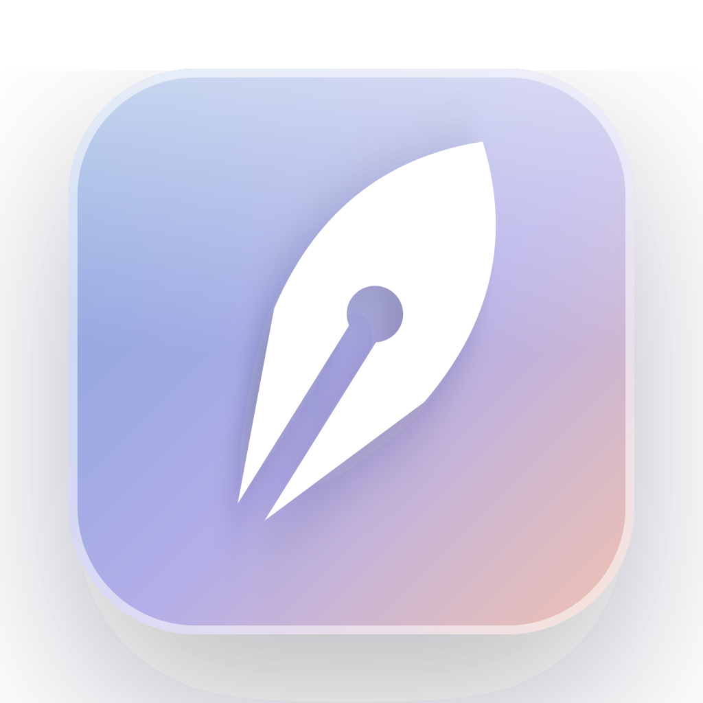
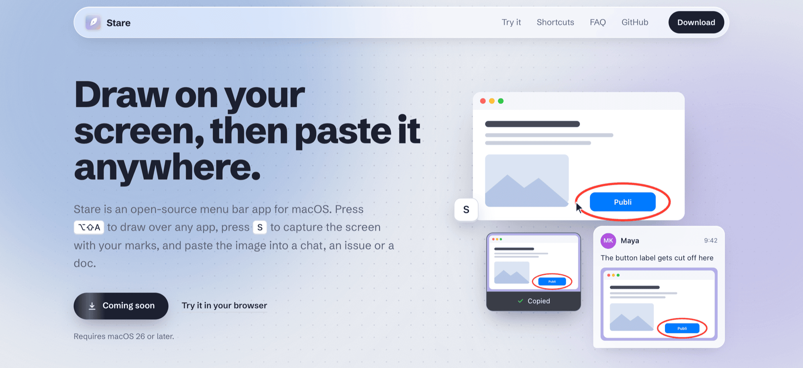

<div align="center">



# Stare

**Draw on your screen, then paste it anywhere.**

An open-source menu bar app for macOS. Press `⌥⇧A` to draw over any app,
press `S` to capture the screen with your marks, and paste the image into a
chat, an issue or a doc.

[**Website**](https://stare.alvaldes.workers.dev) ·
[**Try it in your browser**](https://stare.alvaldes.workers.dev/#try) ·
[**Download**](https://github.com/alvaldes/stare/releases/latest)

<a href="https://stare.alvaldes.workers.dev">
  
</a>

</div>

## Three keys, start to finish

From "look at this" to an image in someone's chat, without leaving your keyboard.

| | |
| --- | --- |
| **1 · Press `⌥⇧A`** | A clear sheet covers every display, even full-screen apps. The app underneath keeps focus. |
| **2 · Mark it up** | Arrows, highlights, boxes, circles and numbered steps, in eight inks. Every tool is one key. |
| **3 · Press `S`, then paste** | Your screen and your marks land on a card in the corner. Copy it, save it or drag it out. |

**Presenting? Point at it.** Press `⌥⇧M` and a ring follows your pointer, so
everyone watching your screen knows where to look. Clicks and focus stay with
the app you're presenting.

Lives in the menu bar · No account to create · Captures stay on your Mac · Open source

## Install

Stare runs on **macOS 26 or later**.

```sh
brew install --cask alvaldes/tap/stare
```

Or download [Stare.dmg](https://github.com/alvaldes/stare/releases/latest/download/Stare.dmg),
open it and drag Stare to Applications.

<details>
<summary>First launch from a browser download</summary>

Stare is not notarized (there is no Apple Developer account behind it), so a
DMG downloaded in a browser is stopped the first time you open it. Choose
**Done**, then open **System Settings → Privacy & Security** and click
**Open Anyway** next to "Stare.app" was blocked. Removing the quarantine flag
also works:

```sh
xattr -d com.apple.quarantine /Applications/Stare.app
```

Homebrew does not quarantine its downloads, so `brew install --cask` opens
Stare without this step.

</details>

**Permissions.** Drawing works without any permission. To capture the screen,
Stare asks for **Screen Recording** once (System Settings → Privacy & Security →
Screen Recording), and updates keep the grant.

## Every tool is one key away

| Keys | What they do |
| --- | --- |
| `⌥⇧A` | Start drawing over any app |
| `⌥⇧W` | Open the whiteboard |
| `⌥⇧M` | Point at things with the pointer highlight |
| `⌥⇧P` | Pin your marks so clicks pass through |
| `P` `H` `A` `L` `R` `O` | Pen, highlighter, arrow, line, rectangle, ellipse |
| `T` `C` `F` `B` `E` | Text, numbered step, laser, blur, eraser |
| `1`–`8` | Red, orange, yellow, green, blue, purple, white, black |
| `S` · `⇧S` | Capture the display · drag to capture an area |
| `⌘Z` · `⇧⌘Z` | Undo · redo |
| `Esc` | Clear and leave |

<details>
<summary>More shortcuts</summary>

| Where | Keys |
| --- | --- |
| Drawing | Hold `⇧` for a straight line with the pen or highlighter, or a square or circle with the rectangle or ellipse |
| Whiteboard | `⌘←` `⌘→` change page (going past the last one adds a page) · `⌘B` flips the page between white and black · hold space and drag to pan |
| Whiteboard | `S` captures the marks over the page colour, no Screen Recording needed · `Esc` closes the board and keeps the pages for the session |
| Capture card | Hover keeps it on screen · click opens the editor · drag it into another app |
| Editor | Same tools and inks · `⌘Z` undo · `⇧⌘Z` redo · `Esc` cancels a crop, then closes |

</details>

## Questions

<details>
<summary>How is it different from a screenshot tool?</summary>

You mark up the live screen first and capture second. There is no editor in
between unless you want one, so pointing at something takes a couple of key
presses.

</details>

<details>
<summary>Does drawing take focus away from the app I am using?</summary>

No. The app underneath stays active, so you can draw over it and keep working
in it.

</details>

<details>
<summary>Where do my captures go?</summary>

Each capture appears as a card in the corner of the screen. Copy it, save it,
or drag it into another app. Stare does not upload anything.

</details>

## Build it yourself

```sh
swift build
swift test
Scripts/bundle.sh release install   # builds Stare.app and copies it to /Applications
```

Architecture, signing, releases and the decisions behind them are in
[docs/DEVELOPMENT.md](docs/DEVELOPMENT.md). The website lives in
[`landing/`](landing/).

## License

[MIT](LICENSE) © 2026 Angel Valdés
